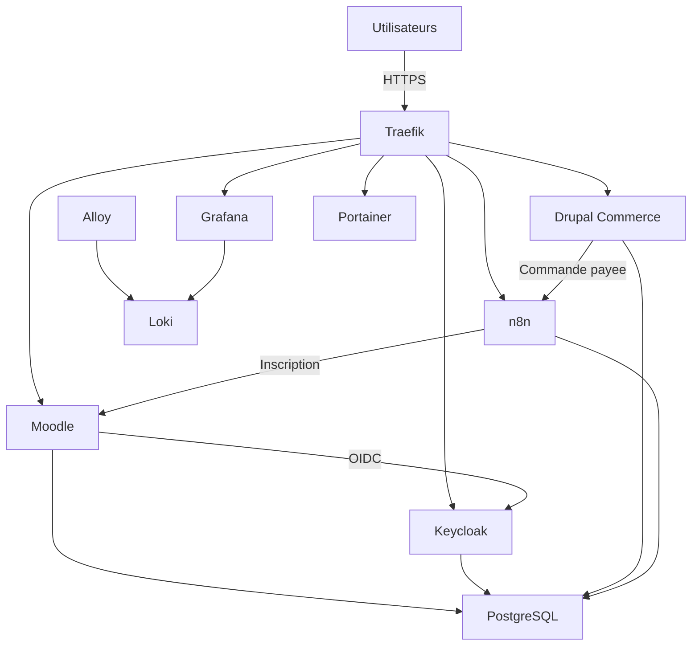

# CR465 – Groupe C

## Plateforme pédagogique conteneurisée sur VM as Code

Ce projet déploie une plateforme de formation sécurisée sur une seule VM Ubuntu 24.04 LTS, avec Cloud-init, Docker Rootless et Docker Compose. Moodle utilise Keycloak pour le SSO ; Drupal Commerce et n8n automatisent l’inscription aux formations après confirmation d’un paiement simulé. Traefik centralise les accès HTTPS, PostgreSQL héberge les données et Alloy, Loki et Grafana centralisent les journaux.

**Version de référence : V5.5.** L’équipe indique que les tests ont réussi.

<!-- https://polymtl-1.gitbook.io/polymtl-docs -->

## Documentation technique

Les chapitres sont consultables directement dans GitHub :

1. [Présentation du projet](documentation-gitbook/presentation.md)
2. [Architecture globale](documentation-gitbook/architecture.md)
3. [VM et Cloud-init](documentation-gitbook/vm-cloud-init.md)
4. [Déploiement Docker Compose](documentation-gitbook/docker-compose.md)
5. [Segmentation réseau](documentation-gitbook/segmentation-reseau.md)
6. [Mesures de sécurité](documentation-gitbook/securite.md)
7. [SSO – Keycloak](documentation-gitbook/sso-keycloak.md)
8. [Workflow n8n et attribution des accès](documentation-gitbook/workflow-n8n.md)
9. [Observabilité](documentation-gitbook/observabilite.md)
10. [Validation et tests](documentation-gitbook/validation.md)
11. [Limites et risques résiduels](documentation-gitbook/limites-et-risques.md)
12. [Contributions des membres de l’équipe](documentation-gitbook/contributions.md)

## Architecture simplifiée

## Sécurité

Docker Rootless, segmentation en quatre réseaux, HTTPS, SSH par clé, UFW, secrets générés localement et comptes PostgreSQL distincts. Les risques résiduels sont détaillés dans la documentation.
