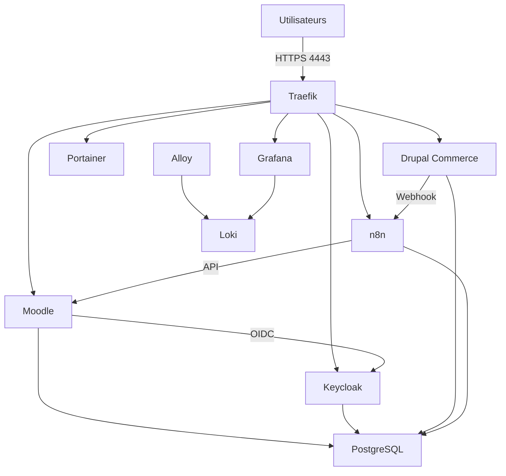

# Architecture globale

## Vue d’ensemble
Une VM Ubuntu 24.04 LTS héberge les services Docker Rootless. Traefik centralise les accès HTTPS ; PostgreSQL 17 héberge les bases applicatives distinctes. Quatre réseaux séparent exposition, applications, données et observabilité.

| Couche | Composants |
|---|---|
| Infrastructure | Cloud-init, Docker Rootless, Docker Compose |
| Exposition | Traefik |
| Applications | Moodle, Keycloak, Drupal Commerce, n8n |
| Données | PostgreSQL |
| Administration | Portainer |
| Observabilité | Alloy, Loki, Grafana |

Schéma logique simplifié ; les appartenances réseau sont détaillées dans le chapitre dédié. WEBTEST est omis pour la lisibilité.

[Retour à la documentation](../README.md)
