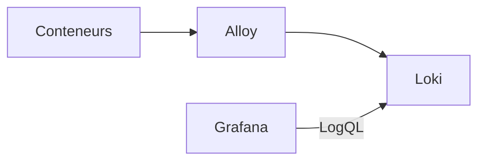

# Observabilité

| Composant | Version | Fonction |
|---|---|---|
| Alloy | 1.10.2 | Collecte |
| Loki | 3.5.5 | Centralisation |
| Grafana | 12.3.0 | Consultation |

Alloy lit les journaux Docker Rootless en lecture seule dans `/home/ubuntu/.local/share/docker/containers` et les transmet à Loki. Grafana est accessible via `https://grafana.groupec.test:4443`.

Dans Explore, sélectionner Loki et utiliser :
```logql
{job="docker-rootless"}
```



Loki et Alloy ne publient pas directement leurs ports sur la VM. La solution est orientée journaux, et non supervision complète des métriques, traces ou détection automatisée.

[Retour à la documentation](../README.md)
