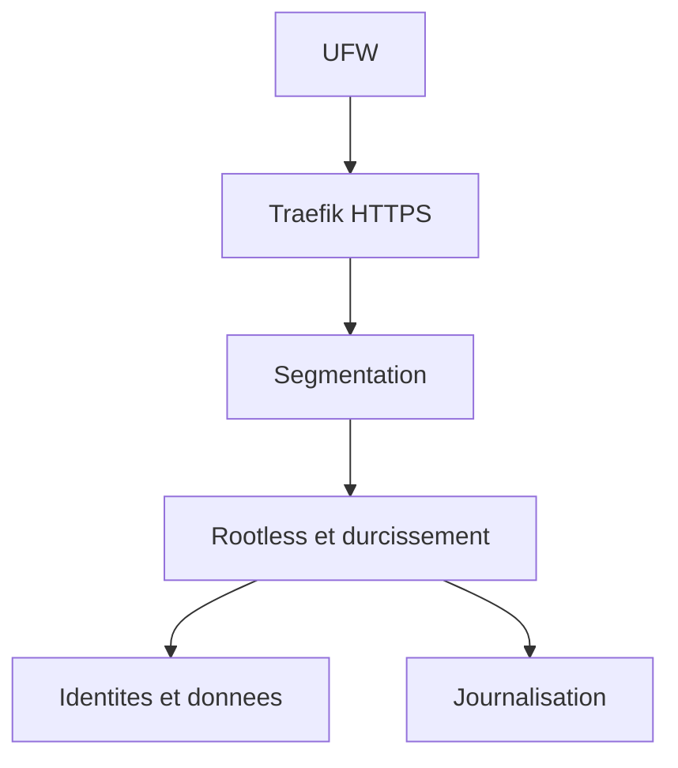

# Mesures de sécurité

## Défense en profondeur
| Domaine | Contrôles |
|---|---|
| VM | Mises à jour initiales, SSH par clé, connexion root et mot de passe SSH désactivés, UFW |
| Conteneurs | Docker Rootless, `no-new-privileges`, `cap_drop`, `read_only` selon compatibilité |
| Ressources | Limites CPU, mémoire et PID, rotation des journaux selon service |
| Réseau | Quatre réseaux, données et observabilité internes |
| HTTPS | Traefik, certificat autosigné, tableau de bord BasicAuth, File Provider sans socket Docker |
| Secrets | Génération locale, permissions restrictives, montages de fichiers et fichiers `.env` protégés |
| Identités | OIDC Moodle, client confidentiel, compte de service dédié |
| Données | Bases et rôles PostgreSQL distincts, révocation de privilèges PUBLIC |
| Automatisation | Jeton du webhook n8n |
| Journaux | Alloy, Loki et Grafana |

Les secrets sont stockés sous `/opt/GroupeC/secrets/`. Aucune valeur réelle ne doit être publiée. Rootless réduit les privilèges sans éliminer les risques d’évasion. Le certificat autosigné exige une gestion de la confiance adaptée au laboratoire.

Schéma conceptuel de défense en profondeur.

[Retour à la documentation](../README.md)
