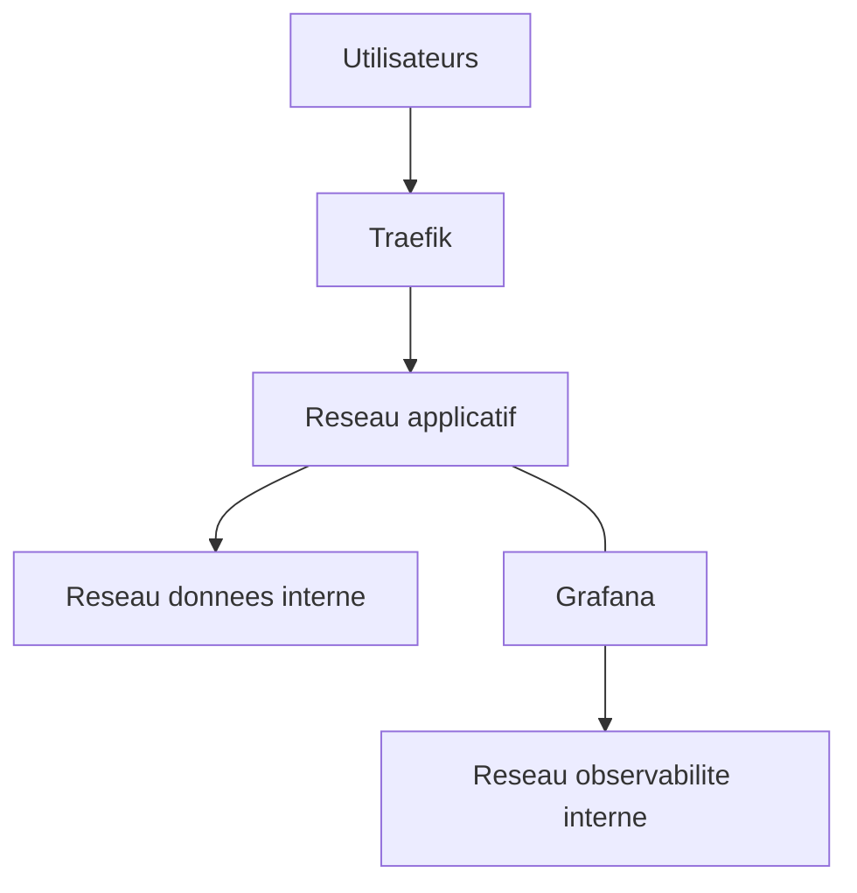

# Segmentation réseau

## Réseaux
| Réseau | Fonction |
|---|---|
| GroupeC-exposition | Couche frontale |
| GroupeC-applicatif | Communications applicatives, `172.28.240.0/24` |
| GroupeC-donnees | Réseau interne PostgreSQL |
| GroupeC-observabilite | Réseau interne des journaux |

Traefik utilise l’adresse `172.28.240.10` sur le réseau applicatif. Grafana relie les réseaux applicatif et observabilité. PostgreSQL n’est pas publié sur l’hôte.

| Port | Exposition |
|---|---|
| 22/TCP | SSH, autorisé par UFW |
| 4443/TCP | HTTPS via Traefik |
| 8081/TCP | HTTP, localhost uniquement |
| 8080/TCP | Santé Traefik, localhost uniquement |
| 5432/TCP | PostgreSQL, réseau interne uniquement |

Ce schéma représente les zones logiques, pas un filtrage individuel des flux. Le réseau applicatif partagé ne constitue pas une microsegmentation complète.

[Retour à la documentation](../README.md)
