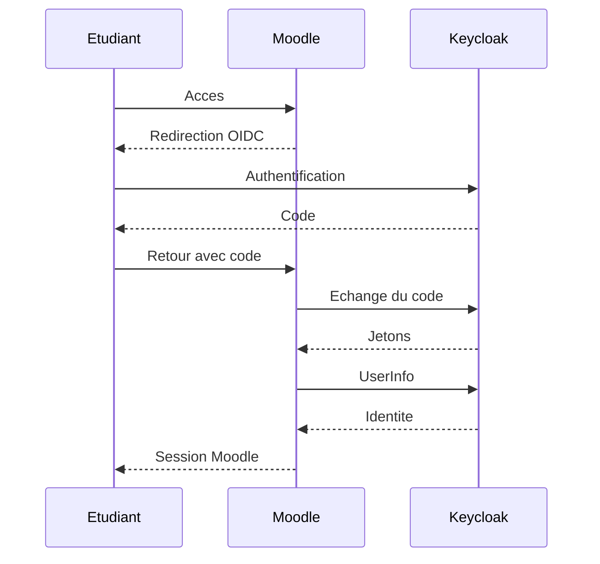

# SSO – Keycloak

Keycloak centralise l’authentification de Moodle via OpenID Connect.

| Paramètre | Valeur |
|---|---|
| Version | 26.8.2 |
| Realm | groupec |
| Client | moodle, confidentiel |
| Flux | Authorization Code |
| Scopes | openid, profile, email |
| URL | https://keycloak.groupec.test:4443 |
| Redirection | https://moodle.groupec.test:4443/admin/oauth2callback.php |

La première connexion crée le compte Moodle. Les flux Implicit et Direct Access Grants et l’inscription libre sont désactivés. L’administrateur permanent est `groupec-admin`. Le plugin `local_groupec_ssofix` traite uniquement le changement de mot de passe forcé du compte de démonstration OAuth2. Le SSO est limité à Moodle dans cette version.

[Retour à la documentation](../README.md)
