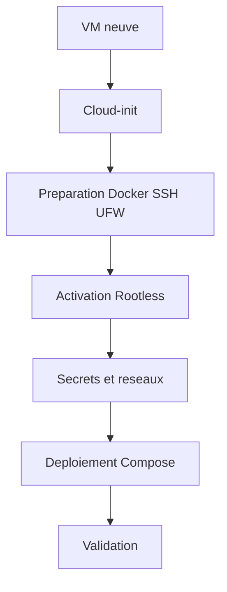

# VM et Cloud-init

## Configuration
| Paramètre | Valeur |
|---|---|
| OS | Ubuntu 24.04 LTS |
| VM | Une seule |
| Utilisateur | ubuntu (fourni par Multipass) |
| SSH | Clé publique, connexion root désactivée |
| Pare-feu | UFW : TCP 22 et 4443 |
| Répertoire | `/opt/GroupeC/` |

## Provisionnement
Cloud-init met à jour le système, installe les dépendances et écrit les configurations (`write_files`). La directive `runcmd` exécute les scripts suivants :

1. `/usr/local/sbin/prepare-docker-rootless.sh` : préparation Docker, SSH et UFW, désactivation du démon privilégié.
2. `/usr/local/sbin/activate-docker-rootless.sh` : activation du service utilisateur et de linger.
3. `/opt/GroupeC/deploy.sh` : secrets, TLS, réseaux et services Compose.

Utiliser une VM neuve, sans volume PostgreSQL préexistant. Le fichier Linux ne configure pas les accès Windows : le script compagnon `GroupeC-Windows-Acces-V5.ps1` est prévu pour le NAT VirtualBox et le fichier hosts dans ce contexte.

[Retour à la documentation](../README.md)
