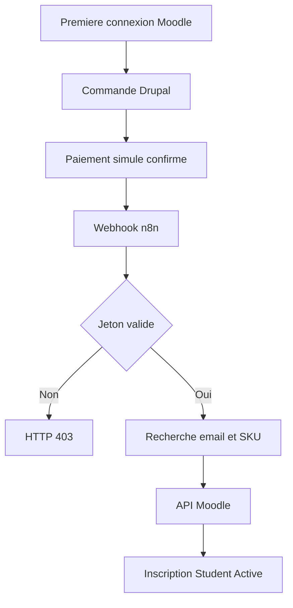

# Workflow n8n et attribution des accès

Le workflow `GroupeCMoodle001` automatise l’inscription Moodle après confirmation manuelle d’un paiement simulé Drupal Commerce.

| Paramètre | Valeur |
|---|---|
| Webhook interne POST | `http://n8n:5678/webhook/commande-payee` |
| Authentification | `X-GroupeC-Token` |
| Compte de service | `n8n-service` |
| API | `enrol_manual_enrol_users` |

Le webhook transmet notamment l’identifiant de commande, l’état, le total payé, l’email et le SKU. Un utilisateur ou cours introuvable entraîne une réponse 422 ; une erreur d’inscription entraîne une réponse 502. Le compte de service bénéficie de permissions limitées. Une première connexion Moodle est nécessaire. Seul le premier SKU est traité ; aucun paiement bancaire réel n’est effectué.

[Retour à la documentation](../README.md)
